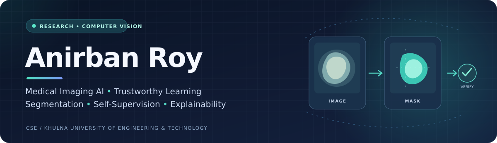

<!-- Profile README for github.com/anirban96roy -->

  

  
  
  

  <strong>KUET CSE Graduate</strong> &nbsp;·&nbsp; Medical Imaging AI &nbsp;·&nbsp; Computer Vision &nbsp;·&nbsp; Trustworthy AI

---

## About me

I'm **Anirban Roy**, a **Computer Science and Engineering graduate** from **Khulna University of Engineering & Technology (KUET), Bangladesh**. My research interests lie at the intersection of **medical imaging, computer vision, and trustworthy artificial intelligence**, with a focus on developing systems that are robust, interpretable, and reliable.

My undergraduate thesis investigated **self-supervised learning for skin lesion classification**. I am currently working on **EMCAD-based medical image segmentation** and **explanation faithfulness in federated medical vision-language learning**. I am particularly interested in generalization across datasets and imaging modalities, as well as the reliability of AI explanations under heterogeneous clinical data.

> **Research direction:** Learning useful visual representations is only part of the challenge; understanding when and why a medical AI system can be trusted matters just as much.

## Research interests

  
  
  
  
  
  
  
  

## Featured research

*Completed thesis work and ongoing research are labeled separately. Descriptions of ongoing projects reflect work in progress rather than completed results.*

<table>
  <thead>
    <tr>
      <th width="31%">Project</th>
      <th>What I'm working on</th>
    </tr>
  </thead>
  <tbody>
    <tr>
      <td>
        <strong>01 · Skin lesion classification</strong> 
        Undergraduate thesis · Completed
      </td>
      <td>
        Developed an <strong>eight-class skin lesion classification</strong> framework using <strong>Rotation and SimCLR self-supervised learning</strong>, feature fusion, and ensemble strategies. Evaluated class-balanced performance and cross-dataset generalization on <strong>ISIC 2019</strong> and <strong>PAD-UFES-20</strong>.
      </td>
    </tr>
    <tr>
      <td>
        <strong>02 · EMCAD medical image segmentation</strong> 
        Ongoing research
      </td>
      <td>
        Exploring <strong>EMCAD</strong> with a <strong>PVTv2-B2 encoder</strong> and <strong>multi-scale attention decoder</strong>. Working on reproducing polyp segmentation experiments using <strong>CVC-ClinicDB</strong> and adapting the framework for <strong>brain tumour MRI segmentation</strong> to study cross-modality generalization.
      </td>
    </tr>
    <tr>
      <td>
        <strong>03 · Faithful medical VLM explanations</strong> 
        Ongoing research
      </td>
      <td>
        Investigating <strong>medical vision-language models</strong> in <strong>federated, non-IID settings</strong>, with an emphasis on evaluating and improving <strong>explanation faithfulness</strong> under heterogeneous clinical data distributions.
      </td>
    </tr>
  </tbody>
</table>

<strong>Additional research interests and projects</strong>

 

- **Emotion-aware adaptive support (ongoing):** Exploring computer vision, contextual information, and feedback-driven reinforcement learning for non-clinical student well-being support.
- **Medical document understanding:** Co-authored research on a YOLO–TrOCR pipeline with dictionary refinement for handwritten medicine-name extraction.
- **Humanitarian technology:** Co-authored *WaveGuard*, a flood monitoring and rescue support system.

## Publications

**2026 · IEEE PECCII**  
**A YOLO–TrOCR Pipeline with Dictionary Refinement for Handwritten Medicine Name Extraction**  
*A. Roy, D. Saha, S. Debnath*  
[DOI: 10.1109/PECCII70991.2026.11662060](https://doi.org/10.1109/PECCII70991.2026.11662060)

**2025 · SoftwareX (Elsevier), Vol. 32**  
**WaveGuard: A Flood Monitoring and Rescue System**  
*A. N. Likhan, A. Roy, M. S. Salim, S. I. Hossain*  
[DOI: 10.1016/j.softx.2025.102361](https://doi.org/10.1016/j.softx.2025.102361)

  <a href="https://scholar.google.com/citations?user=fiXHcgkAAAAJ"><strong>See research on Google Scholar →</strong></a>

## Research toolkit

**Machine learning & vision**

  
  
  
  
  
  
  

**Development & research workflow**

  
  
  
  
  

## Recognition and collaboration

- **1st Runner-Up**, Three Minute Thesis (3MT), IEEE CUET SciBlitz 1.0 (2025), presenting work on reinforcement learning for maternal healthcare decision support.
- Interested in interdisciplinary collaborations across **medical image analysis**, **self-supervised learning**, and **trustworthy AI**.

## Let's connect

I'm happy to connect with researchers and developers working on **medical image analysis, computer vision, trustworthy AI, and data-efficient representation learning**.

**[Email](mailto:roy2007096@stud.kuet.ac.bd)** · **[Google Scholar](https://scholar.google.com/citations?user=fiXHcgkAAAAJ)** · **[LinkedIn](https://www.linkedin.com/in/anirban-roy007/)** · **[GitHub](https://github.com/anirban96roy)**

Currently exploring how medical AI can be accurate, interpretable, and reliable across real-world settings.

